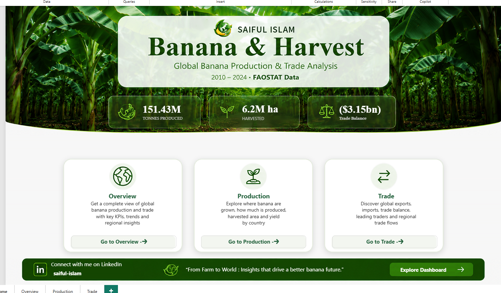
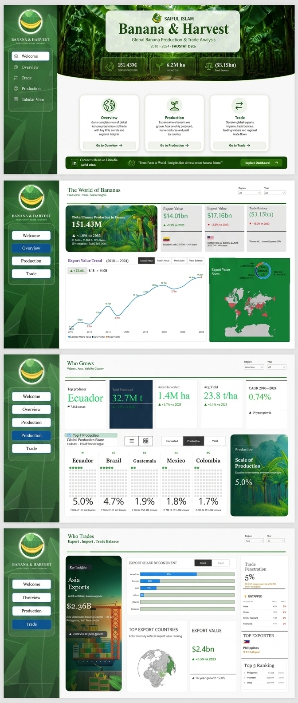
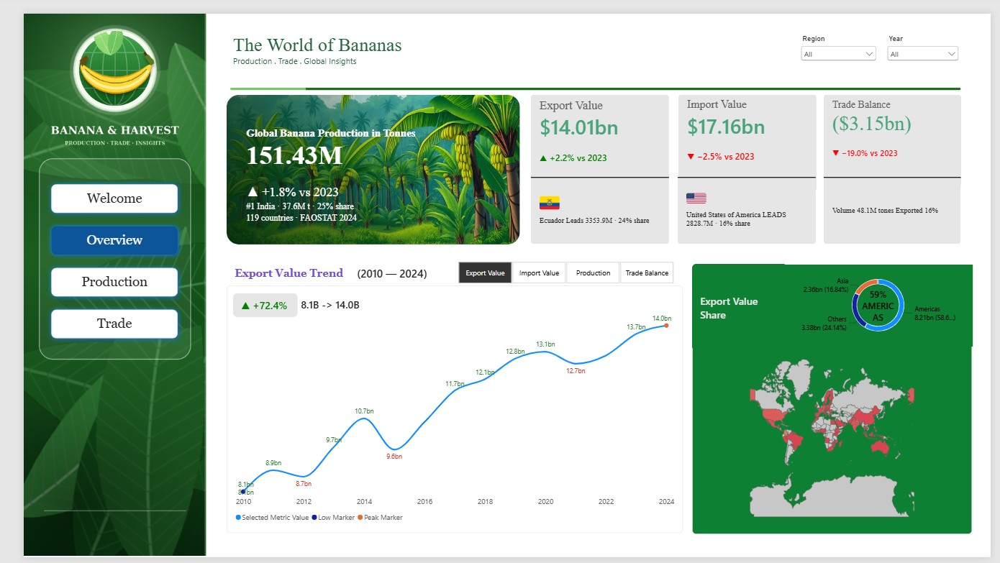
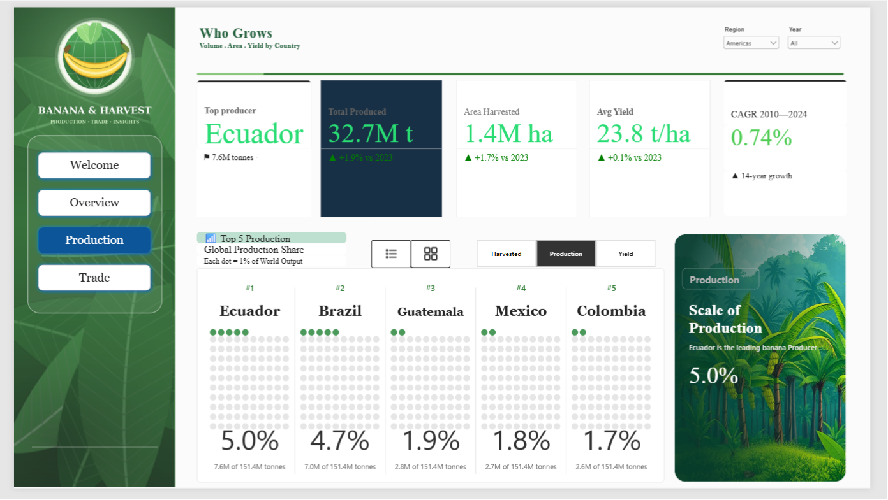
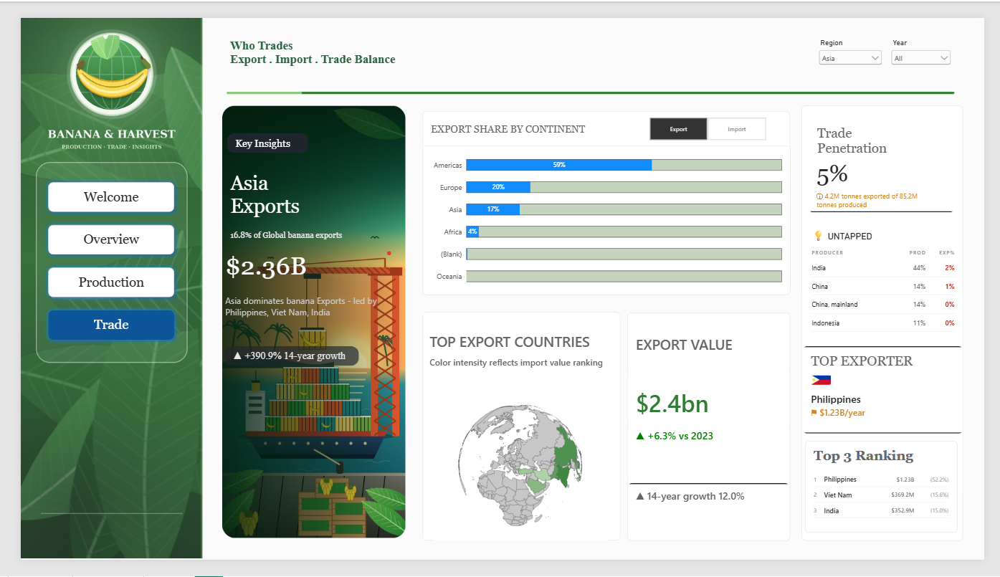
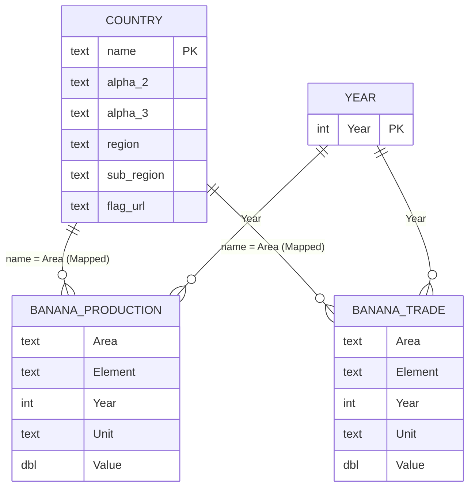

<div align="center">

# 🍌 Banana & Harvest

### Global Banana Production & Trade Analytics — Power BI

*A four-page interactive dashboard that turns 15 years of FAOSTAT data into a clear story of who grows, who exports and who imports the world's most traded fruit.*


[**▶ Live Dashboard**](https://app.powerbi.com/view?r=eyJrIjoiNGNmMGQxY2ItZTEzMi00YjQwLWI2YzgtY2YyYTM1YjRiY2Q0IiwidCI6Ijk4NWUxYzNlLTFmOWUtNDViNy1hZWZiLWM3NWMyMGIwNmI1ZCIsImMiOjEwfQ%3D%3D) &nbsp;•&nbsp; [**Report a Bug**](../../issues) &nbsp;•&nbsp; [**Connect on LinkedIn**](https://www.linkedin.com/in/saiful-islam-7b7a64268/?isSelfProfile=true)

<br>



</div>

---

## Table of Contents

1. [Project Summary](#1-project-summary)
2. [Business Questions](#2-business-questions)
3. [Key Findings](#3-key-findings)
4. [Dashboard Walkthrough](#4-dashboard-walkthrough)
5. [Data Model](#5-data-model)
6. [DAX Highlights](#6-dax-highlights)
7. [Data Source & Preparation](#7-data-source--preparation)
8. [Design Approach](#8-design-approach)
9. [Tech Stack](#9-tech-stack)
10. [Repository Structure](#10-repository-structure)
11. [Getting Started](#11-getting-started)
12. [Data Notes & Limitations](#12-data-notes--limitations)
13. [Roadmap](#13-roadmap)
14. [Author](#14-author)

---

## 1. Project Summary

**Banana & Harvest** is an end-to-end Power BI project covering the full analytics workflow: raw FAOSTAT extracts → Power Query cleaning → a star-schema data model → 150+ DAX measures → a designed, navigable four-page report.

The dashboard lets a user move from the global picture (total output, trade balance) down to individual countries and continents, with **Year** and **Region** filters available on every analytical page.

| | |
|---|---|
| **Domain** | Agriculture · International trade |
| **Period** | 2010 – 2024 (15 years) |
| **Grain** | Country × Year × Element (production and trade facts) |
| **Pages** | Welcome · Overview · Production · Trade |
| **Primary audience** | Analysts, students, and recruiters reviewing end-to-end BI skills |

<br>

<div align="center">



<sub>All four report pages in navigation order.</sub>

</div>

---

## 2. Business Questions

The report is organised around the questions a commodity or agri-business analyst would ask first:

- **Supply:** Who produces the most bananas, on how much land, and at what yield?
- **Growth:** How fast is global production growing, and which producers are driving it? (CAGR 2010–2024)
- **Trade:** Which countries and continents dominate exports and imports, and what is the global trade balance?
- **Opportunity:** Which large producers export very little of what they grow (the *untapped* export potential)?
- **Concentration:** How much of global output and export value sits with the top few countries?

---

## 3. Key Findings

Figures below are for the latest year in the dataset (**2024**) unless a period is stated.

| Indicator | Result |
|---|---|
| Global production | **151.43 M tonnes** |
| Area harvested | **6.21 M hectares** (average yield **24.4 t/ha**) |
| Production growth | **+1.8 %** vs 2023 · **1.5 % CAGR** 2010–2024 |
| Export value | **$14.01 bn** (+2.2 % vs 2023) |
| Import value | **$17.16 bn** (−2.5 % vs 2023) |
| Trade balance | **−$3.15 bn** — the world imports more banana value than it exports |
| Top producer | **India** — 37.6 M t, about **24.8 %** of world output |
| Top exporter | **Ecuador** — $3.35 bn, **23.9 %** of export value |
| Top importer | **United States** — $2.83 bn, **16.5 %** of import value |
| Export growth | $8.1 bn → $14.0 bn, **+72.4 %** between 2010 and 2024 (≈ 4.0 % CAGR) |
| Trade penetration | About **15.5 %** of production is exported; most bananas are consumed where they are grown |

**Reading the numbers**

- **Production is Asian; exporting is American.** India leads output, yet the Americas account for roughly **59 % of export value** ($8.2 bn), led by Ecuador.
- **Trade penetration is low.** Large producers such as India export only a small share of their volume, which the *Untapped* panel on the Trade page highlights.
- **Imports exceed exports in value terms**, producing a structural deficit in the dataset.

---

## 4. Dashboard Walkthrough

### 🏠 Welcome — *Landing page*
A branded landing page with three headline KPIs (tonnes produced, hectares harvested, trade balance) and navigation to each analytical page. Built from a DAX-driven design with page-navigation buttons.


### 🌍 Overview — *The World of Bananas*
The executive summary: production headline card, export / import / trade-balance KPI cards with year-over-year deltas and the leading country behind each, a switchable 2010–2024 trend (Export Value · Import Value · Production · Trade Balance) with low and peak markers, and an export-share map by region.



### 🌱 Production — *Who Grows*
Top producer, total production, area harvested, average yield and CAGR in a KPI strip, followed by a **Top-5 Global Production Share** dot-matrix (each dot = 1 % of world output) switchable between *Harvested*, *Production* and *Yield*, and a "Scale of Production" insight panel.



### 🚢 Trade — *Who Trades*
A key-insight panel for the selected region, export-vs-import share by continent, a top-export-countries map, export value with 14-year growth, trade penetration, the *Untapped* producers table, top exporter and a Top-3 ranking.



> **Interactivity:** every analytical page responds to the **Year** and **Region** slicers. Metric selector buttons switch the same visual between measures without duplicating charts.

---

## 5. Data Model

The model follows a **star schema**: two fact tables (production, trade) share two conformed dimensions (country, year). All relationships are one-to-many, single-direction.



| Table | Type | Rows | Purpose |
|---|---|---|---|
| `Banana_Production` | Fact | 5,869 | Production quantity, area harvested, yield (FAOSTAT) |
| `Banana_Trade` | Fact | 9,102 | Export / import value and quantity (FAOSTAT) |
| `country` | Dimension | — | ISO codes, region, sub-region, flag image URL |
| `year` | Dimension | 15 | Year slicer and time-based calculations |
| `Metric Selector`, `Trade Selector`, `Prod Metric`, `Rank Slots` | Helper | — | Disconnected tables powering metric switchers and ranking slots |
| `All Measures`, `global measures`, `Who grows Measures`, `Page 3 measures` | Measure tables | — | 150+ DAX measures grouped by page / purpose |

**Modelling decisions**

- **Name harmonisation.** FAOSTAT writes the Netherlands as *"Netherlands (Kingdom of the)"* while the country dimension uses *"Netherlands (Kingdom of)"*. A calculated column, `Area (Mapped)`, normalises the name on both fact tables so that all 150 producing areas join to the dimension without orphan rows.
- **Disconnected selector tables** let one visual switch between metrics (export value, import value, production, balance) instead of building a separate chart for each.
- **Measures are never stored as columns.** All KPIs are measures so they respond correctly to the Year and Region filters.

---

## 6. DAX Highlights

A few representative measures (the model contains 150+).

**Trade balance** — positive is a surplus, negative a deficit:
```dax
Trade Balance = [Export Value] - [Import Value]
```

**Trade penetration** — how much of what is produced actually crosses a border:
```dax
Trade Penetration % = DIVIDE ( [Export Qty (t)], [Total Production] )
```

**Production CAGR** — compound annual growth between the first and last year in the dataset, independent of the slicer selection and guarded against zero or missing values:
```dax
Production CAGR % =
VAR fy = CALCULATE ( MIN ( 'Year'[Year] ), ALL ( 'Year' ) )
VAR ly = CALCULATE ( MAX ( 'Year'[Year] ), ALL ( 'Year' ) )
VAR sv = CALCULATE ( [Total Production], REMOVEFILTERS ( 'Year' ), 'Year'[Year] = fy )
VAR ev = CALCULATE ( [Total Production], REMOVEFILTERS ( 'Year' ), 'Year'[Year] = ly )
VAR n  = ly - fy
RETURN
    IF ( n > 0 && sv > 0 && ev > 0, POWER ( DIVIDE ( ev, sv ), 1 / n ) - 1 )
```

**Patterns used across the model:** `VAR`/`RETURN` for readable logic, `DIVIDE` for safe division, `CALCULATE` with `REMOVEFILTERS` / `ALL` for fixed-period benchmarks, `TOPN` + `CONCATENATEX` for "Top-N" text, `SWITCH` driven by selector tables for dynamic metrics, and year-over-year delta measures with conditional colour measures.

---

## 7. Data Source & Preparation

| | |
|---|---|
| **Source** | [FAOSTAT](https://www.fao.org/faostat/en/) — Food and Agriculture Organization of the United Nations |
| **Datasets** | FAOSTAT crops & livestock products — production and trade extracts |
| **Item** | Bananas |
| **Period** | 2010 – 2024 |
| **Reference data** | `countries.xlsx` — ISO codes, regions, sub-regions and flag URLs |
| **Load mode** | Import |

**Power Query steps**

1. Load the FAOSTAT CSV extracts and promote headers.
2. Set explicit data types (text, whole number, decimal).
3. Remove columns that carry no analytical value (for example `Domain` on the production table).
4. Load the country reference table from Excel.
5. Add `Area (Mapped)` in the model to reconcile country naming between FAOSTAT and the reference table.

---

## 8. Design Approach

- **Consistent visual identity** — a banana-green palette, serif headings and a persistent left navigation panel on every page.
- **Navigation** — page-navigation buttons that highlight the active page.
- **Custom KPI cards** — several cards (landing page, KPI strips, Top-N panels) are rendered from **DAX measures that return HTML/SVG**, so values, colours and labels update with the filters without relying on static images.
- **Conditional formatting** — green / red delta indicators for year-over-year movement.
- **Progressive disclosure** — summary first (Overview), then detail (Production, Trade).

---

## 9. Tech Stack

| Layer | Tool |
|---|---|
| Data source | FAOSTAT CSV extracts, Excel reference table |
| ETL | Power Query (M) |
| Modelling & calculations | Power BI Data Model, DAX |
| Visualisation | Power BI Desktop (native visuals, page-navigation buttons, HTML/SVG measures) |
| Publishing | Power BI Service |

---

## 10. Repository Structure

```text
banana-and-harvest/
├── assets/                      # Screenshots used in this README
│   ├── welcome.png
│   ├── overview.png
│   ├── production.png
│   ├── trade.png
│   └── all_pages.png
├── data/
│   ├── Banana_Production.csv    # FAOSTAT production extract (2010–2024)
│   ├── Banana_Trade.csv         # FAOSTAT trade extract (2010–2024)
│   └── countries.xlsx           # Country / region reference table
├── Banana_and_Harvest.pbix      # Power BI report
├── LICENSE
└── README.md
```

---

## 11. Getting Started

### Option A — View online
Open the **[live dashboard](https://app.powerbi.com/view?r=eyJrIjoiNGNmMGQxY2ItZTEzMi00YjQwLWI2YzgtY2YyYTM1YjRiY2Q0IiwidCI6Ijk4NWUxYzNlLTFmOWUtNDViNy1hZWZiLWM3NWMyMGIwNmI1ZCIsImMiOjEwfQ%3D%3D)**. No installation is required.

### Option B — Open locally

1. **Clone the repository**
   ```bash
   git clone https://github.com/<your-username>/banana-and-harvest.git
   cd banana-and-harvest
   ```
2. **Open** `Banana_and_Harvest.pbix` in [Power BI Desktop](https://powerbi.microsoft.com/desktop/) (free).
3. **Re-point the data source** — in *Transform data → Data source settings*, change the file paths to the `data/` folder on your machine, then click **Refresh**.
4. **Explore** — use the **Year** and **Region** slicers and the page buttons to navigate.

> **Requirement:** Power BI Desktop (current release). The Welcome page uses an HTML/SVG-rendering visual; if it appears blank, install the visual from AppSource when Power BI prompts you.

---

## 12. Data Notes & Limitations

- **Units differ by domain.** Production is in tonnes (t) and area in hectares (ha); trade is in US dollars. Values across the two domains are not directly comparable.
- **Aggregates and overlapping names.** FAOSTAT publishes both aggregate and country-level records (for example *China* alongside *China, mainland*). Rankings that include both can double-count; this is flagged for the next version (see roadmap).
- **FAOSTAT naming.** Country names follow FAOSTAT terminology and may differ from common short names.
- **Coverage.** The production extract contains 150 countries and areas and the trade extract 200 areas, so totals depend on the records FAOSTAT holds for each year.
- **Purpose.** The report is built for exploration and comparison. For official statistics, always refer to the original FAOSTAT data and its terms of use.

---

## 13. Roadmap

- [ ] Exclude aggregate regions and resolve *China / China, mainland* duplication in Top-N rankings
- [ ] Add a **Tabular View** page for country-by-country comparison and export
- [ ] Add an **Information** page documenting definitions and methodology in-report
- [ ] Add price-per-tonne (unit value) analysis from trade value and quantity
- [ ] Add row-level security example by region
- [ ] Automate refresh from the FAOSTAT API

---

## 14. Author

**Saiful Islam** — Data Analyst

- LinkedIn: [YOUR_LINKEDIN_URL](YOUR_LINKEDIN_URL)
- Email: YOUR_EMAIL
- Portfolio: YOUR_PORTFOLIO_URL

Feedback, suggestions and collaboration ideas are welcome — please open an [issue](../../issues) or message me directly.

---

<div align="center">

*From farm to world: insights that drive a better banana future.* 🍌

⭐ If you found this project useful, consider giving the repository a star.

</div>
